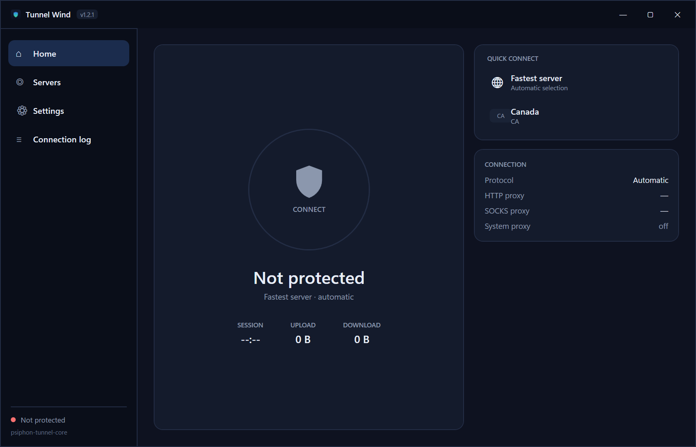
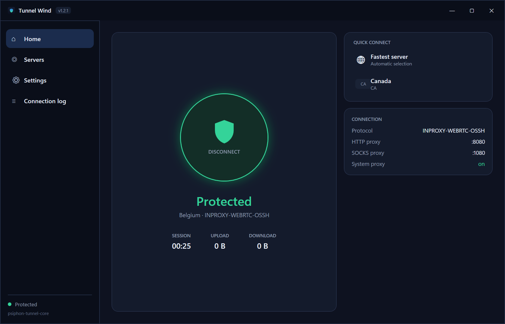
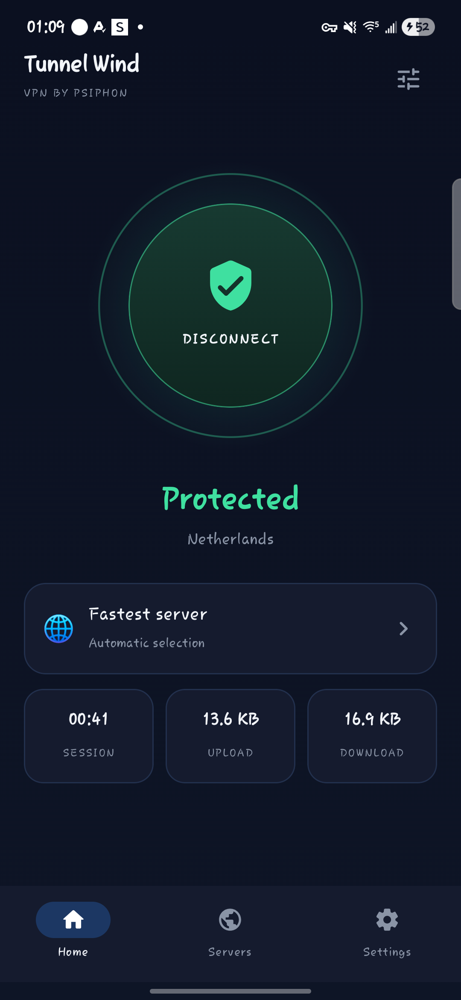
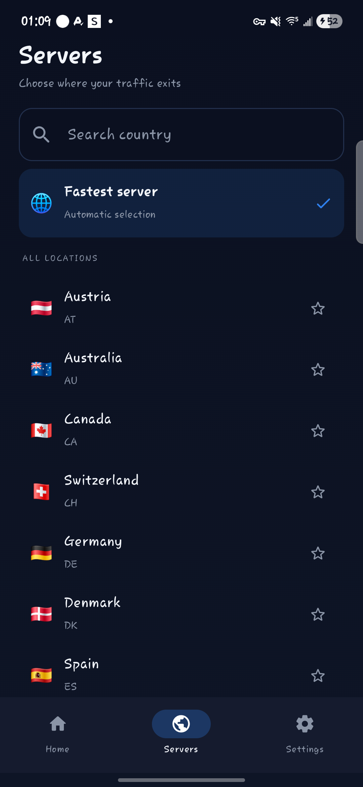
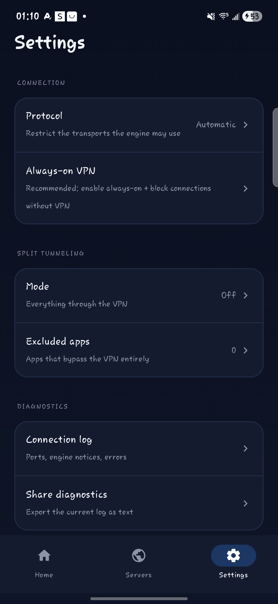

# 🌬 Tunnel Wind

<p align="center">
  
  &nbsp;&nbsp;
  
</p>

<p align="center"><em>Left: desktop client, not connected. Right: protected through Italy (<b>INPROXY-WEBRTC-OSSH</b>) with the Windows system proxy applied, live ports and session stats.</em></p>

A modern, open Windows client built on top of the **psiphon-tunnel-core** engine.
This project was created by reverse engineering the complete architecture of the
official Psiphon 3 Windows client (see [`ANALYSIS.md`](ANALYSIS.md)), then rebuilding
every part around it in clean, auditable code.

> **What it is**
> A .NET 8 WPF app that spawns the official `psiphon-tunnel-core.exe` engine and
> manages the entire client experience: bootstrap, server selection, system proxy,
> split tunneling, update channel, integrity checks, tray, autostart.

> **What it is not**
> It does not bundle or redistribute the engine itself. Before you can build/run, you
> (or your build agent) extract `psiphon-tunnel-core.exe` **from your own, legally
> obtained copy of Psiphon** — the reverse-engineered extraction procedure is fully
> documented in [`EXTRACTION_LOG.txt`](EXTRACTION_LOG.txt) and automated in
> [`build.ps1`](TunnelWind/build.ps1) once the file is in place.

---

## Feature set

| Area | Detail |
|---|---|
| Engine | Spawns `psiphon-tunnel-core` as a subprocess with a config file; notices streamed on stderr and parsed into UI state |
| Bootstrap | Pre-fetches the remote server list over standard Windows TLS (SChannel) and writes it into the engine's own datastore — engine validates RSA list + Ed25519 per-entry signatures as it would with its own download |
| Trust anchors | All the public distribution constants recovered from the shipped client (`Bootstrap.cs`) |
| Servers | Searchable country browser with favorites (★), recents and per-region latency (TCP probe over the real uplink); selection hot-restarts the tunnel |
| Split tunnel | Per-country bypass via `SplitTunnelOwnRegion` / `SplitTunnelRegions`, plus an editable list |
| System proxy | WinInet user-scope proxy with crash-safe backup / restore, stale-proxy guard at startup, LAN exposure (`ListenInterface: any`) |
| Update channel | Manifest-driven `update.json` (`appVersion`, `appUrl`, `appSha256`, `engineUrl`, `engineSha256`); SHA-256-verified swap of engine (pin rotation) and app (rename dance) |
| Hardening | Engine hash pinning (`engine.sha256`), orphan sweep, kill-mode (proxy restore on engine death), single-instance mutex |
| Tray | Live tray icon with context menu (Show / Connect / Disconnect / Exit), close-to-tray, balloon notifications |
| UX | Desktop shell (1120×720 custom chrome, sidebar navigation, hero status, in-app settings), protocol lock (SSH / OSSH / TLS-OSSH / QUIC-OSSH / Meek), fixed or automatic local ports, traffic counters, "start with Windows" |

## Layout

> **Releases:** prebuilt `v1.2.1` app packages (x64 + ARM64, framework-dependent) live at
> <https://github.com/jmor22/TunnelWind/releases/tag/v1.2.1>. The engine is **not** shipped in
> releases — obtain your own legitimate copy of Psiphon and run
> [`TunnelWind/update/refresh-engine.ps1`](TunnelWind/update/refresh-engine.ps1) to extract and
> install the engine locally (it also pins and verifies the hash every time).

```
TunnelWind/
  src/TunnelWind.Code/          # core library (engine, config, proxy, update, integrity)
  src/TunnelWind.App/           # WPF UI (net8.0-windows, x64 + ARM64)
  engine/                       # engine binary (not in repo; see extraction doc)
  update/                       # update.json + LocalUpdateServer.ps1 + packager
build.ps1                       # portable-dotnet build script (doubles as tool installer)
```

## Build

```
git clone https://github.com/jmor22/TunnelWind.git
cd TunnelWind
powershell -ExecutionPolicy Bypass -File tools/get-dotnet.ps1      # portable .NET 8 SDK (no admin)
powershell -ExecutionPolicy Bypass -File build.ps1                 # x64
powershell -ExecutionPolicy Bypass -File build.ps1 -arm64          # ARM64 (Windows-on-ARM)
```

Runtime prerequisites are already inside the portable bundle; no system installs.

## Run

`TunnelWind\output\TunnelWind.exe`

1. Put your `psiphon-tunnel-core.exe` inside `TunnelWind\engine\` (one-time).
2. Press **CONNECT**; the log walks you through every engine stage.
3. When disconnected (or issues), tray → Exit restores your system proxy from backup.

## Android client (`TunnelWind/mobile`)

<p align="center">
  
  &nbsp;&nbsp;
  
  &nbsp;&nbsp;
  
</p>

<p align="center"><em>Home (protected, hero power control + live stats) · Servers (search, favorites, recents) · Settings</em></p>

A native Kotlin/Compose VpnService client around the **official Psiphon Android
library** (`psiphontunnel`, engine `psiphon-tunnel-core` c4a09096ab / v2.0.42).
It calls the Go binding (`psi.Psi.start`) directly instead of the Java wrapper,
which gives full control over bootstrap and provider callbacks.

| Area | Detail |
|---|---|
| Bootstrap | Downloads `server_list_compressed` over direct internet **before** the tun exists, zlib-inflates it and passes the hex entry list as `embeddedServerEntryList` — the engine's own fetch fails on-device exactly like on Windows |
| DNS | Real uplink resolvers are captured before the tun hides them and handed to the engine (`GetDNSServersAsString`); the tun itself advertises the official transparent-DNS router address |
| Tun | Official Psiphon addressing scheme: private subnet with a **different** DNS address (e.g. `172.16.0.1/12`, DNS `172.16.0.2`) so DNS packets actually enter the tunnel |
| Engine sockets | `useDeviceBinder=true` → engine calls `bindToDevice`, host answers `VpnService.protect()`; mandatory in VPN mode |
| UI | Compose, Nord-style: bottom navigation (Home / Servers / Settings), hero shield/power control, one status line, live session/upload/download stats, diagnostics sheet |
| Servers | searchable country list with flags, favorites (★) and recents, persisted; the last region list is cached so it is usable before the next connect; **latency per region** (TCP probe over the real uplink, colour-coded, refreshable) |
| Settings | protocol lock (SSH / OSSH / TLS-OSSH / QUIC-OSSH / Meek), split tunneling (off / own country / country list), per-app exclusions, always-on VPN shortcut, share diagnostics |
| Automation | auto-connect on app launch and after reboot (stale boot broadcasts ignored), optional Wi-Fi-only rule, 10-minute grace after a manual disconnect |
| Shell | Quick Settings tile (connect / disconnect from the shade), notification with a Disconnect action, Android 12 splash screen, adaptive launcher icon |
| First run | 3-step onboarding; bundled **Inter** typeface (SIL OFL, see `TunnelWind/mobile/licenses/Inter-OFL.txt`) |
| Resilience | 180 s connect watchdog, auto-reconnect (3 attempts with backoff) when the engine exits unexpectedly, uplink-change detection (`Psi.networkChanged()`), kill switch (tun traffic dropped while connecting/stopping), battery-optimisation exemption request, crash log persisted for the next launch |

Built and verified on a Galaxy S21 FE (Android 16): 429 server entries imported,
21 egress regions, real protocol dials (SSH/OSSH/TLS/QUIC/meek/WebRTC),
`Tunnels{count:1}`, working DNS + browsing through the tunnel.

**Build** (the engine AAR is *not* in this repo — drop your own
`psiphontunnel-2.0.42.aar` into `TunnelWind/mobile/libs/`):

```
cd TunnelWind/mobile
gradle :app:assembleDebug
adb install -r app/build/outputs/apk/debug/app-debug.apk
```

For a shareable build, add `keystore.properties` (gitignored) pointing at your
release keystore; `gradle :app:assembleRelease` then produces a signed,
**arm64-v8a only** APK (~41 MB instead of ~135 MB):

```
storeFile=keystore/tunnelwind-release.jks
storePassword=...
keyAlias=tunnelwind
keyPassword=...
```

## Security notes

* The system proxy is flipped on only when the tunnel is up. Every Prepare → Apply
  step writes a **proxy backup file** so a future run (or a crash) can restore the
  previous user configuration.
* The engine binary is hash-pinned on first run; any modification or wrong-method
  insertion blocks CONNECT.
* The engine's own persistence (`%LOCALAPPDATA%\TunnelWind\data\…`) is used as-is,
  so you never need to trust an intermediate cache.
* **No engine binaries are ever redistributed from this repo.**

## Legal / licensing

* This repo's code: see [`LICENSE.md`](TunnelWind/LICENSE.md) (it says explicitly:
* TunnelWind wrapper code: see [`TunnelWind/LICENSE.md`](TunnelWind/LICENSE.md).
* `psiphon-tunnel-core` source: https://github.com/Psiphon-Labs/psiphon-tunnel-core ;
  use of Psiphon's network / API requires adherence to their Do-No-Harm license
  (personal use is fine, redistribution of the engine itself is not).
* You are responsible for compliance in your jurisdiction.

## Documentation

* [`ANALYSIS.md`](ANALYSIS.md) — the complete reverse-engineering report (UPX
  unpacking, embedded PEs, config-builder decompilation, engine wire contract,
  notices…)
* [`EXTRACTION_LOG.txt`](EXTRACTION_LOG.txt) — exact byte-provenance of every
  extracted constant (SHA-256s, file offsets, decompiled key addressing)
* [`TunnelWind/README.md`](TunnelWind/README.md) — engine bootstrap pipeline details
  (base64 transfer URLs, numeric `ClientVersion`, stderr notices, `"data"` payloads…)
